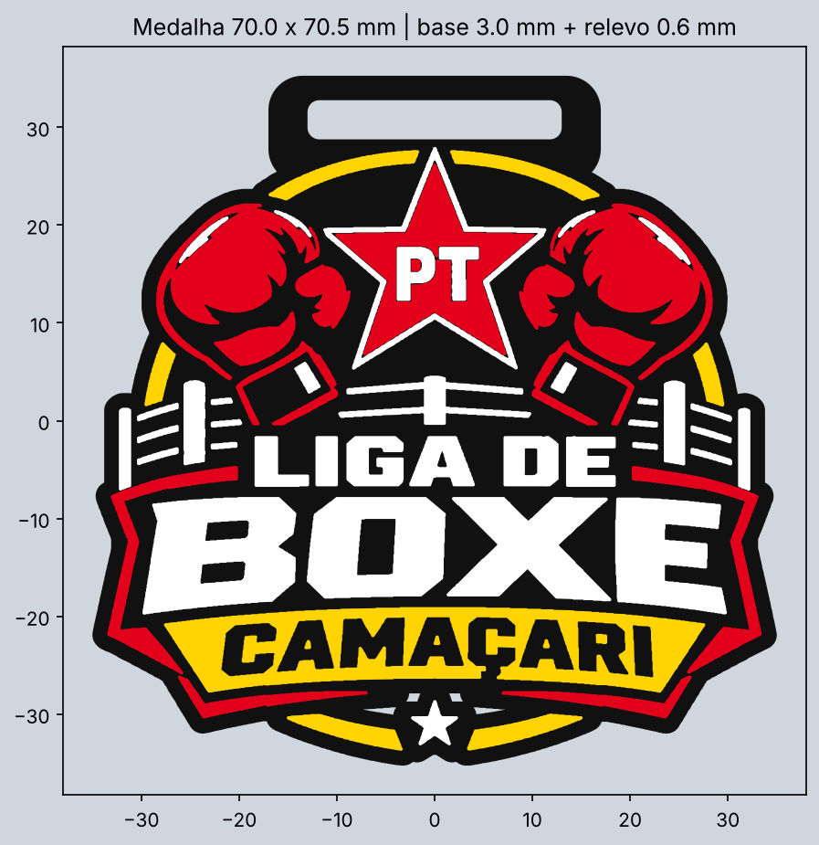

# Medalha Liga de Boxe Camaçari

Medalha multicolorida para a **Snapmaker U1** (4 cores), feita a partir do `logo.png`.

- Tamanho: **70 x 70,5 mm**
- Base preta de **3 mm** com o formato do logo e borda de 1,5 mm
- Cores em relevo de **0,6 mm** sobre a base (espessura total de 3,6 mm)
- Alça no topo com **fenda de 26 x 4 mm** para fita de até 25 mm

## Arquivos
| Arquivo | Uso |
|---|---|
| `medalha_liga_boxe.3mf` | Um objeto com 4 partes (preto_base, vermelho, amarelo, branco), no formato multicolor do PrusaSlicer |
| `medalha_colorida.glb` | Só para **visualizar** no celular. Fatiadores não abrem esse formato |
| `stl/medalha_*.stl` | Uma STL por cor (alternativa ao 3MF) |
| `gerar_medalha.py` | Script que gera tudo; os parâmetros (tamanho, espessura, fenda) ficam no topo |

## Como fatiar
**Snapmaker Orca, OrcaSlicer, Bambu Studio e PrusaSlicer**
1. Abra o `medalha_liga_boxe.3mf` com a impressora **Snapmaker U1** selecionada.
2. O fatiador cria os filamentos 1 a 4 e coloca cada parte no seu: **1 preto, 2 vermelho, 3 amarelo, 4 branco**.
3. Acerte as cores dos 4 filamentos na barra lateral, já que as cores criadas automaticamente podem ser outras.

**Qualquer fatiador (alternativa com STL)**
1. Selecione os 4 arquivos da pasta `stl/` de uma vez e abra.
2. Quando o fatiador perguntar se é **um objeto com várias partes**, responda **Sim**.
3. Escolha o filamento de cada parte: preto_base, vermelho, amarelo e branco.

Use camada de 0,2 mm, ou de 0,12–0,16 mm para detalhes mais nítidos, e imprima deitada, sem suportes.
